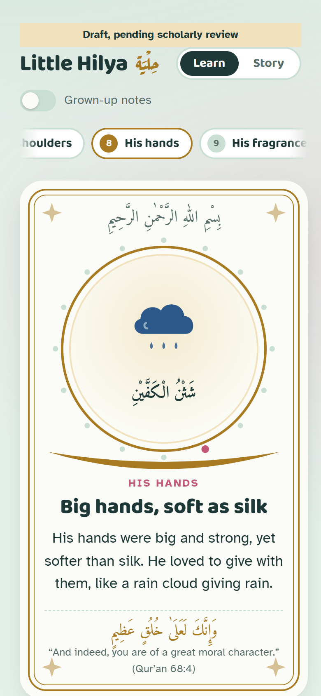
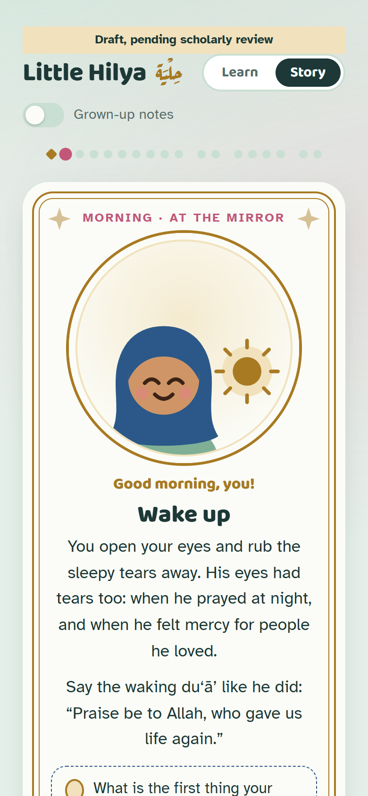

# Little Hilya

<table>
  <tr>
    <td></td>
    <td></td>
  </tr>
</table>

A child-friendly walkthrough of the physical description and character of the Prophet ﷺ from
al-Shamāʾil al-Muḥammadiyya (Tirmidhi). It never depicts him.

- **Learn**: 17 stations from head to toe, each with the description, a character trait and its
  signs (mujiza, karama, khasisa).
- **Story**: "A Day with the Hilya", 17 beats in which the child looks in the mirror.

Arabic and English throughout, with a toggle for grown-up notes. The site works offline and can be
installed as an app.

## Status

Draft, pending scholarly review. Pages are `noindex`. Corrections to translations live in
`data/corrections.json`; the text from sunnah.com is left as published.

## Develop

Bun is the only runtime needed.

```sh
bun install
prek install && prek install --hook-type pre-push
bun run dev
```

## Content

Edit the typed files, not the generated output:

- `src/data/stations/NN-<id>.ts`: one station per file.
- `src/data/story/NN-<slug>.ts`: one story beat per file.
- `data/texts.json`: the cited hadith, keyed by sunnah.com reference (`shamail:8`). Generated; see
  below.
- `data/corrections.json`: translation corrections, applied at build.

Types catch bad references and traits. Run `bun run images` after changing a station card or page
(it regenerates the link previews and the PWA screenshots; it runs locally and needs Edge). Run
`bun run icons` after changing `assets/icon.svg`.
CI fails on stale previews, so a change to `global.css` or a card needs `bun run images` (and its
PNGs committed) before CI passes. The install screenshots are not checked for freshness.

`concept/` is the frozen original prototype and is not part of the build.

### Hadith texts

```sh
bun run corpus   # build the local corpus in .cache/corpus/
bun run texts    # rewrite data/texts.json from it
bun run search -- --root رحم --en mercy --collection shamail   # find hadith; --help for options
```

`bun run corpus` downloads the two sources at pinned revisions (set in `scripts/corpus/build.ts`)
and writes one JSON line per hadith to `.cache/corpus/corpus.jsonl`, keyed by sunnah.com reference.
The Hugging Face dataset holds less than half of Sahih Muslim, so the build adds the rest from
fawazahmed0/hadith-api, deriving each sunnah.com number from its `arabicnumber` (`2331.01` is
`2331a`). Rows whose number may not match sunnah.com carry `ref_uncertain`; check them there before
citing. The add-on is also written in the dataset's own columns to `.cache/corpus/addon/`, with a
README on how it was made.

`bun run texts` collects every ref cited in `src/data/stations/` and `src/data/story/` and copies
those hadith from the corpus. It fails on a ref the corpus lacks. Arabic is the source text; English
is sunnah.com's, with `data/corrections.json` applied at build.

### Other sources

For research only: the site cites sunnah.com refs alone. `bun run corpus` also downloads these at
pinned versions (each file checked against its sha256) into `.cache/corpus/downloads/<source>/`
and writes `.cache/corpus/sources/<source>.jsonl`. `.cache/corpus/sources.json` gives each source's
kind, edition and licence. Refs are `<source>:<key>`:

- Hadith, with the editor's numbering: Musnad Ahmad (`ahmad:N`, al-Arna'ut), al-Darimi
  (`darimi:N`, Asad, with his grade), al-Hakim's Mustadrak (`hakim:N`, with al-Dhahabi's Talkhis as
  the grade), al-Tabarani's al-Mu'jam al-Kabir (`tabarani-kabir:V/N`, as numbering restarts by
  volume) and Abu Nu'aym's Dala'il (`abunuaym-dalail:N`).
- By volume and page, `-2`, `-3` … for later records on the same page: al-Bayhaqi's Dala'il
  (`bayhaqi-dalail:1/215`), Ibn Sa'd's Tabaqat (`ibnsad`), al-Qadi 'Iyad's al-Shifa (`shifa`) and
  the Shama'il commentaries of al-Qari (`qari-jam`) and Ibn Hajar al-Haytami (`haytami-ashraf`).
- Lexicons by root: Lisan al-'Arab (`lisan:ضلع`), al-Nihaya (`nihaya:شنب`), Maqayis al-Lugha
  (`maqayis`), Taj al-'Arus (`taj`) and Lane's Lexicon (`lane:ضلع`, English with Arabic headwords).
- The Quran (`quran:68:4`): Tanzil's Uthmani text with Pickthall's English.

The OpenITI texts are unvowelled. A page is the one a record starts on; where the edition marks no
page, only the volume is known, and al-Tabarani's may be off by one near a volume change.

## Checks

```sh
bun run lint
bun run check       # types, content and preview-image freshness
bun test
bun run check:dist  # after bun run build
```

The same checks run in CI and in the prek hooks (commit and push).

## Deploy

- GitHub Pages deploys from `main`. First time: Settings → Pages → Source: GitHub Actions.
- Cloudflare Workers Builds gives each branch a preview. Connect the repo there with the build
  command `bun install && bun run build`.

## Credits

Texts, references and grades are from [sunnah.com](https://sunnah.com), used with permission, via
the [freococo/sunnah_dataset](https://huggingface.co/datasets/freococo/sunnah_dataset) dataset
(CC BY-NC-SA 4.0). The rest of Sahih Muslim comes from
[fawazahmed0/hadith-api](https://github.com/fawazahmed0/hadith-api) (Unlicense).
The research corpus adds:

- Classical Arabic texts from the [OpenITI](https://github.com/OpenITI/RELEASE) corpus, release
  v2025.1.9 (CC BY-NC-SA 4.0).
- The Quran text from [Tanzil](https://tanzil.net) (CC BY 3.0): it may be copied only verbatim,
  with its copyright notice and a link to tanzil.net. Pickthall's translation is also from Tanzil.
- Lane's Lexicon as corrected by [laneslexicon](https://github.com/laneslexicon/lexicon_xml): "Text
  provided by Perseus Digital Library, with funding from The U.S. Department of Education and The
  Max Planck Society." Perseus's availability statement is kept in `.cache/corpus/sources.json`.

Fonts (Amiri, Aref Ruqaa, Atkinson Hyperlegible, Baloo 2) are self-hosted through Fontsource.
