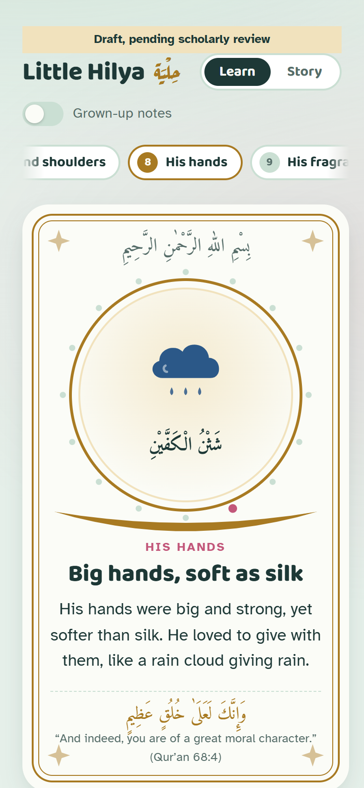
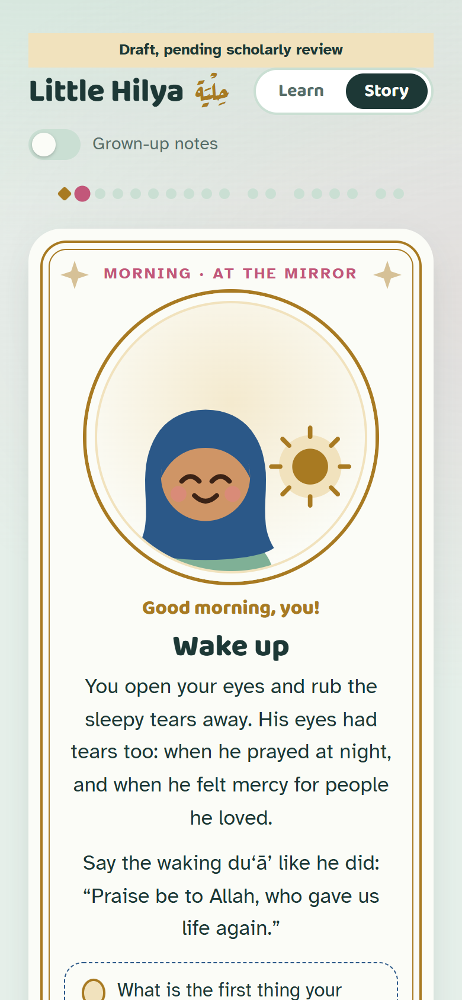

# Little Hilya

<table>
  <tr>
    <td></td>
    <td></td>
  </tr>
</table>

A child-friendly walkthrough of the physical description and character of the Prophet ﷺ from
al-Shamāʾil al-Muḥammadiyya (Tirmidhi). It never depicts him.

- **Learn**: 17 stations from head to toe, each with the description, a character trait and its
  signs (mujiza, karama, khasisa).
- **Story**: "A Day with the Hilya", 17 beats in which the child looks in the mirror.

Arabic and English throughout, with a toggle for grown-up notes. The site works offline and can be
installed as an app.

## Status

Draft, pending scholarly review. Pages are `noindex`. Corrections to translations live in
`data/corrections.json`; the text from sunnah.com is left as published.

## Develop

Bun is the only runtime needed.

```sh
bun install
prek install && prek install --hook-type pre-push
bun run dev
```

## Content

Edit the typed files, not the generated output:

- `src/data/stations/NN-<id>.ts`: one station per file.
- `src/data/story/NN-<slug>.ts`: one story beat per file.
- `data/`: sunnah.com texts, references and translation corrections.

Types catch bad references and traits. Run `bun run images` after changing a station card or page
(it regenerates the link previews and the PWA screenshots; it runs locally and needs Edge). Run
`bun run icons` after changing `assets/icon.svg`.
CI fails on stale previews, so a change to `global.css` or a card needs `bun run images` (and its
PNGs committed) before CI passes. The install screenshots are not checked for freshness.

`concept/` is the frozen original prototype and `tools/sunnah/` holds the old scrape scripts; neither
is part of the build.

## Checks

```sh
bun run lint
bun run check       # types, content and preview-image freshness
bun test
bun run check:dist  # after bun run build
```

The same checks run in CI and in the prek hooks (commit and push).

## Deploy

- GitHub Pages deploys from `main`. First time: Settings → Pages → Source: GitHub Actions.
- Cloudflare Workers Builds gives each branch a preview. Connect the repo there with the build
  command `bun install && bun run build`.

## Credits

Texts, references and grades are from [sunnah.com](https://sunnah.com), used with permission.
Fonts (Amiri, Aref Ruqaa, Atkinson Hyperlegible, Baloo 2) are self-hosted through Fontsource.
